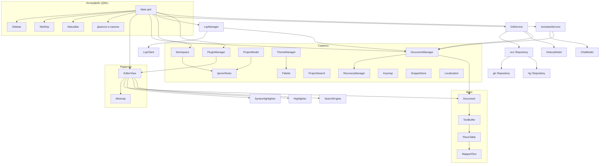

# MyCodeApp — справочник по классам

Документ для разработчика: из каких классов состоит программа, за что отвечает
каждый, как они связаны и в каких потоках работают. Публичный API описан
в заголовках (`src/**/*.h`) — здесь его смысл и правила использования.

## Содержание

1. [Слои и связи](#1-слои-и-связи)
2. [Общие правила](#2-общие-правила)
3. [Ядро — `src/core`](#3-ядро--srccore)
4. [Редактор — `src/gui`](#4-редактор--srcgui)
5. [Сервисы — `src/services`](#5-сервисы--srcservices)
6. [Языковые серверы — `src/lsp`](#6-языковые-серверы--srclsp)
7. [Контроль версий — `src/git`](#7-контроль-версий--srcgit)
8. [Ассистент — `src/assistant`](#8-ассистент--srcassistant)
9. [API плагинов — `include/mycodeapp`](#9-api-плагинов--includemycodeapp)
10. [Интерфейс — `qml`](#10-интерфейс--qml)
11. [Точка входа — `main.cpp`](#11-точка-входа--maincpp)
12. [Как расширять](#12-как-расширять)

---

## 1. Слои и связи



Слои зависят только «вниз»: ядро не знает ни о Qt Quick, ни о сервисах;
`EditorView` знает о ядре и подсветке, но не о вкладках и проекте; связывает
всё `Main.qml`.

## 2. Общие правила

**Правки текста.** Любое изменение текста — только через
`core::Document::replace()`: так оно попадает в историю отмены, в журнал
восстановления (сигнал `Document::edited`) и в журнал правок буфера, которым
питается инкрементальная подсветка. Правка на нескольких курсорах — один вызов
с вектором `Replacement`, то есть один шаг отмены.

**Потоки.** Все объекты живут в GUI-потоке. Фоновая работа (загрузка больших
файлов, поиск, tree-sitter, обход проекта, git) получает неизменяемый снимок
`PieceTable::Snapshot` (копия за O(1)) или собственные данные и возвращает
результат в GUI-поток через `QMetaObject::invokeMethod(..., Qt::QueuedConnection)`.
Мьютексов вокруг текста нет. Устаревшие фоновые результаты отбрасываются по
номеру поколения (`m_generation`, `m_runId`, номер запроса).

**Позиции.** `TextBuffer::Position {line, column}` — с нуля, столбец — индекс
`QChar` (UTF-16, как в LSP). На экране используется визуальная колонка
(табуляция до кратной 4 позиции) — `core::editing::visualColumn`. Ряд —
строка на экране после вычета свёрнутых.

**Данные пользователя.** Все пути к настройкам, сессиям, журналам, темам,
сниппетам и плагинам строятся от `appDataDir()` (`src/services/appsettings.h`),
а не от `QStandardPaths` напрямую — иначе сломаются портативный режим и профили.

**Строки интерфейса.** Только через `qsTr()` / `tr()`; вне `QObject` —
`QCoreApplication::translate("Контекст", "...")`. Исходный язык — русский.

---

## 3. Ядро — `src/core`

Чистый C++ поверх `QtCore`, без GUI. Покрыто тестами `test_piecetable`,
`test_core`, `test_document`, `test_editing`, `test_folding`, `test_snippet`.

### `core::PieceTable`
Хранилище текста. Текст = неизменяемый оригинал файла (или `MappedText`) +
буферы добавок; документ описывается списком кусков-окон в эти буферы.
Вставка разрезает кусок, удаление выбрасывает его часть — существующий текст
не копируется. Рядом хранится строковый индекс: смещения всех `'\n'`,
обновляемые инкрементально.

| Метод | Назначение |
|---|---|
| `reset(text)`, `reset(mapped)` | новый оригинал; история кусков сбрасывается |
| `insert(offset, text)`, `remove(offset, count)` | правка по абсолютному смещению в `QChar` |
| `line(i)`, `lineLength(i)`, `lineCount()`, `offsetToLine(o)` | строковый слой |
| `snapshot()` | неизменяемый снимок для фоновых потоков |
| `verify()` | сверка индекса с текстом — только для тестов |

**`PieceTable::Snapshot`** — копия состояния (контейнеры Qt с неявным
разделением). Правки живой таблицы его не задевают. `forEachLine(fn, from)` проходит
строки с `from` без поиска начала каждой; `chunkAt` отдаёт непрерывный кусок без
копирования (читатель tree-sitter).

### `core::MappedText`
Файл от 256 МБ, отображённый в память (`QFile::map`), как неизменяемый текст.
Только UTF-8 и Latin-1 (в них `'\n'` — один байт). Индекс — смещения `'\n'`
в `QChar` и байтовое начало каждой 16-й строки; строки декодируются по запросу.
Создаётся через `open(path, utf8, progress)`; `nullptr` — не удалось.

### `core::TextBuffer`
Буфер документа: `PieceTable` + кодировка + перевод строк + журнал правок.

| Метод | Назначение |
|---|---|
| `load(path)`, `loadFromData(bytes)` | чтение с автоопределением кодировки (BOM, валидность UTF-8, эвристика cp1251) |
| `loadMapped(path, progress)` | отображение гигантского файла; `false` — грузить обычно |
| `save(path)` | атомарная запись (`QSaveFile`) в исходной кодировке и переводах строк |
| `replace`, `insertText`, `removeText` | правки; переводы строк внутри — только `'\n'` |
| `takeEdits(&overflow)` | забрать журнал правок (`Edit`: смещения и позиции до/после) |
| `snapshot()` | снимок для фона |

Перечисления `Encoding` (UTF-8, UTF-16 LE/BE, Windows-1251, Latin-1) и
`LineEnding` (LF, CRLF, CR). На Windows cp1251 — через WinAPI, на других ОС — ICU.

### `core::Document` (`QObject`)
Файл: путь + `TextBuffer` + история отмены. Живёт в GUI-потоке.

| Член | Назначение |
|---|---|
| `load`, `loadAsync` | загрузка; асинхронная — в `QThreadPool`, готовность — `loadFinished(ok)`, прогресс — `loadProgress` |
| `loadVirtual(buffer, path)` | текст не с диска (просмотр изменений git): только чтение, сохранение запрещено |
| `save`, `saveAs` | сохранение; снимает флаг «изменён» |
| `replace(parts, kind, before)` | единственная точка правки; `EditKind::Typing` склеивает ввод в один шаг до паузы в 1 с или разрыва группы |
| `undo`, `redo` | возвращают выделения для восстановления курсоров |
| `breakUndoGroup()` | следующий ввод — новый шаг (курсор переместили) |
| `changedOnDisk`, `reload`, `acceptDiskVersion` | изменения файла снаружи |
| `replayEdits` | проиграть журнал восстановления одним шагом |
| сигналы `dirtyChanged`, `edited`, `reloaded` | для вкладок, журнала, редактора |

`isDirty()` следует истории: отмена до сохранённого шага снимает флаг.
`isReadOnly()` — отображённый в память или виртуальный документ.

### `core::editing` (функции)
Правила редактирования без состояния: `visualColumn` / `columnAtVisual` /
`expandTabs` (табуляция), `detectIndent` → `IndentStyle` (табы или пробелы,
ширина), `closingFor`, `isOpeningBracket` и т.п., `matchingBracket`
(парная скобка с ограничением по числу строк).

### `core::folding`
`canFold(buffer, line)` — дешёвая проверка для маркера в gutter;
`foldEnd(buffer, line)` — последняя скрываемая строка блока (по последней
незакрытой скобке строки, иначе по отступам).

**`FoldSet`** — свёрнутые блоки (вложенные допустимы) и отображение
строка ↔ ряд: `rowOf`, `lineAt`, `rowCount`, `isHidden`, `isFolded`, `reveal`.
`applyEdit` сдвигает блоки под правку, а задетые многострочной правкой — разворачивает.

### `core::snippet`
`expand(body, variables)` разбирает сниппет в синтаксисе VS Code/LSP
(`$1`, `${1:заглушка}`, `${1|a,b|}`, `$0`, зеркала, `$ПЕРЕМЕННАЯ`,
`${ПЕРЕМЕННАЯ:запасной}`, экранирование) и возвращает `Expansion`: итоговый
текст и позиции ввода (`TabStop` с диапазонами) в порядке обхода, `$0` — последней.

---

## 4. Редактор — `src/gui`

### `EditorView` (`QQuickItem`, QML: `EditorView`)
Редактор на нодах Qt Scene Graph. Показывает один `Document` (свойство
`document`); при переключении вкладок запоминает для каждого документа
курсоры, прокрутку и свёрнутые блоки (`ViewState`). Один документ может быть
открыт в двух видах (разделённый экран): вид, забравший журнал правок
(`takeEdits`), раздаёт его остальным через `Document::shareEdits` →
`editsShared`; те сдвигают свёртку, курсоры и дерево tree-sitter.

**Ряды и перенос.** Ряд — строка экрана. Без переноса ряд = видимая
(не свёрнутая) строка (`FoldSet`). С переносом (`wordWrap`) строка занимает
несколько рядов: `editing::wrapStarts` даёт колонки начала рядов (по словам,
продолжения сдвинуты на отступ), `m_wrapExtra` — лишние ряды каждой строки
(при правке пересчитываются только задетые строки, `spliceWrap`),
`m_wrapBefore` — накопленная сумма с учётом свёртки. Всё экранное идёт через
`rowOf`/`lineAt`/`screenOf`/`visualAtScreen`/`spanRects`.

**Рендер.** `updatePaintNode` собирает ноды только для видимых рядов
и окна колонок (строки по 10 МБ не раскладываются целиком): слои фона diff,
текущей строки, выделений, совпадений, скобок, плашек свёрнутого, текста
(по ноде на цвет), волнистых линий диагностики, кареток; в gutter — номера,
маркеры сворачивания и полоски git. При прокрутке меняется только матрица
трансформации. Буфер читается в `updatePaintNode` без блокировок — GUI-поток
в это время стоит. Смена темы (`Palette::changed`) пересоздаёт ноды.

**Курсоры.** Вектор `Caret {cursor, anchor, goal}` отсортирован и без
пересечений (`normalizeCarets`), основной — `m_primary`. Все команды
(ввод, удаление, перемещение, умный ввод, отступы) применяются ко всем
курсорам; правка — один `Document::replace`.

| Группа | Методы и свойства |
|---|---|
| Правка | `copy`, `cut`, `paste`, `undo`, `redo`, `save`, `applyTextEdits(edits, caretEdit, caretOffset)` — правки от LSP одним шагом |
| Курсоры | `selectNextOccurrence`, `addCaretVertical`, `singleCaret`, `goTo(line, column, length)` |
| Для плагинов и ассистента | `text`, `setText`, `selectedText`, `replaceSelection`, `hasSelection` (свойство); из C++ — `textDocument()`, `selectedLines(from, to)`, `languageOf(path)` |
| Сниппеты | `insertSnippet(body, line, from, to)`, `snippetActive`; Tab / Shift+Tab / Esc обрабатывает сам |
| Сворачивание | `foldAtCursor`, `unfoldAtCursor`, `foldAll`, `unfoldAll` |
| Поиск | `find`, `findNext`, `findPrev`, `clearSearch`; сигнал `searchUpdated` |
| Git | `setChangeMarks(doc, marks)` — полоски в gutter; `setDiffLines(doc, kinds, numbers)` — режим просмотра изменений; `gotoChange(direction)` |
| LSP | `setDiagnostics`, `wordBeforeCursor`, `wordAtCursor`, `colorAt(line, column)` (цвет под мышью: `color`, `hex`, `rgb`, `hsl`), `caretRectangle`; сигналы `textTyped`, `hoverRest`, `hoverLeft`, `definitionClicked` |
| Сессия | `viewStateOf(doc)`, `setViewStateOf(doc, state)` |
| Для миникарты | `styledLines(firstRow, count, maxColumn)`, `rowCount`, `textFont`, сигнал `contentChanged` |

Подсветка: `SyntaxHighlighter` (tree-sitter), пока дерево не готово или
для языков без грамматики — `Highlighter`. После каждой правки
`afterTextChange` забирает журнал правок документа и передаёт его
сворачиванию, tree-sitter и сессии сниппета.

### `Minimap` (`QQuickItem`, QML: `Minimap`)
Уменьшенная копия текста справа от редактора с рамкой видимой области.
Картинка (`QImage` → текстура) пересобирается при правке, подсветке,
сворачивании и сдвиге первого ряда. `level` 1–3: полоски или символы
мелким и крупным шрифтом; ширина — `implicitWidth`. Если ряды не помещаются,
карта прокручивается пропорционально редактору. Ctrl+колесо меняет масштаб.

---

## 5. Сервисы — `src/services`

### `DocumentManager` (QML: `DocumentManager`)
Вкладки: открытие (большие файлы — асинхронно, с прогрессом), закрытие,
сохранение, текущая вкладка. Следит за файлами на диске
(`QFileSystemWatcher` + опрос раз в 2 с): без правок — тихо перечитывает,
с правками — сигнал `externalChange` (диалог «Загрузить с диска / Оставить мою»).
Подключает документы к `RecoveryManager`; `restoreUnsaved()` открывает файлы
из журналов при старте. `find(path)` — открытый документ по пути (им пользуются
LSP, Git и ассистент); `pathKey(path)` — ключ для сравнения путей: регистр
не важен только на Windows.

### `RecoveryManager`
Журнал несохранённых правок: на документ — файл `<папка данных>/recovery/<хэш>.log`
(заголовок с размером и временем файла на диске + записи правок). Записи
копятся в памяти и дописываются раз в секунду и при выходе. Восстановление —
файл с диска + проигрывание записей одним шагом отмены; журнал удаляется, когда
документ снова совпадает с диском или закрыт без сохранения.

### `Workspace` (QML: `Workspace`)
Открытая папка проекта: фоновый обход файлов с учётом `.gitignore`
(до 200 тыс.), `findFiles` — нечёткий поиск для Ctrl+P (`fuzzyScore`: имя файла
важнее папок), сессия `sessions/<sha1 пути>.json`, последняя папка. Также
даёт QML доступ к `settings.json` (`setting`, `setSetting`).

### `IgnoreRules`
Правила `.gitignore` всех уровней и `.git/info/exclude`: `*`, `**`, `?`, `[...]`,
`!`, привязка к папке. Потокобезопасный кэш правил по папкам. Используется
обходом проекта, деревом и поиском по проекту.

### `ProjectModel` (QML: `ProjectModel`)
Модель дерева для `TreeView`: `QSortFilterProxyModel` над `QFileSystemModel`
без игнорируемого, папки выше файлов. Роли `path`, `isDir`, `gitStatus`
(буква от `GitService`, обновляется по `decorationsChanged`).

### `ProjectSearch` (QML: `ProjectSearch`)
Поиск подстроки по всем файлам проекта в фоне: пропускает файлы больше 20 МБ
и двоичные, до 20 тыс. совпадений, результаты пачками раз в 100 мс. Модель —
плоский список «заголовок файла, его совпадения» с HTML-превью.

### `SearchEngine`
Поиск в одном документе по снимку в `QThreadPool`; новый запуск отменяет
предыдущий. Результат — `resultsReady(QVector<Match>)`.

### `SyntaxHighlighter`
Подсветка на tree-sitter (C/C++, Python, QML, Markdown, CMake). Запросы
поддерживают условия `#match?`, `#eq?`, `#any-of?` (и `not-`) по однострочным узлам. Разбор — в фоне по снимку,
одна задача за раз; правки сразу применяются к текущему дереву (`ts_tree_edit`),
правки во время разбора докатываются на результат. `highlightLines` отдаёт
фрагменты для видимых строк; цвет — `color(rule)` из темы, начертание (жирный,
курсив, зачёркнутый, подчёркнутый) — `fontStyle(rule)`. Вложенные языки
(запрос `<язык>-injections.scm`: захваты `@inline`, `@injection.language` +
`@injection.content`) разбираются тем же фоновым заданием отдельными деревьями
по участкам основного: разметка абзацев Markdown — грамматикой markdown-inline,
код в ``` — грамматикой названного языка (`languageNamed`). Файлы больше
8 млн символов не разбираются. Новый язык: грамматика (FetchContent) +
`assets/queries/<язык>.scm` + строка в `languageFor`.

### `Highlighter`
Подсветка регулярными выражениями из `assets/highlight.json` (JSON, Markdown
и запасной вариант). Правила построчные, приоритет — порядок в файле. Цвет —
по полю `type` из темы, иначе из правила.

### `Palette`
Текущие цвета редактора (`EditorColors`) и подсветки по виду (`syntax(type)`).
Значения по умолчанию — тёмная тема (работают в тестах). Сигнал `changed`.

### `ThemeManager` (QML-синглтон)
Темы: встроенные `assets/themes/{dark,light}.json` и свои `themes/*.json`.
Тема — разделы `ui` (цвета интерфейса → `Theme.qml`), `editor` (→ `Palette`),
`syntax`; недостающие цвета берутся из `base`. Файл текущей своей темы
отслеживается — изменения применяются при сохранении, ошибка JSON уходит
в `message`. `createUserTheme()` создаёт копию текущей и возвращает путь.

### `Keymap` (QML-синглтон)
Сочетания клавиш команд. Каждый пункт меню — `Command.qml` с id и сочетанием
по умолчанию, объявляет себя через `declare`; действующее сочетание —
`sequence(id, default)`. Переопределения — в `keybindings.json` (отслеживается).
`assign` снимает сочетание с другой команды и возвращает её название;
`shortcutFromKey` переводит нажатие в строку по скан-коду (не зависит от раскладки).

### `SnippetStore` (QML-синглтон)
Сниппеты в формате VS Code: встроенные `assets/snippets/<язык>.json`, свои —
`snippets/<язык>.json` и `snippets/global.json` (свой префикс заменяет встроенный,
файлы отслеживаются). `completions` — варианты для списка автодополнения,
`expandAtCursor` — раскрытие по Tab, `userFile` — свой файл языка.

### `PluginManager` (QML: `PluginManager`)
Плагины из `<exe>/plugins` и `<папка данных>/plugins`. Описание читается из
метаданных DLL без загрузки; совместимость — по IID. Включённые загружаются
при старте, выключение выгружает DLL без перезапуска (команды плагина
удаляются до выгрузки). Для каждого плагина — свой `PluginHost`, который
работает с редактором (`editor`). Свойства `plugins`, `commands`; методы
`setEnabled`, `run`, `rescan`.

### `Localization` (QML-синглтон)
Язык интерфейса: `applySavedLanguage()` из `main()` до загрузки QML,
`setLanguage(code)` — переключение на лету (`QQmlEngine::retranslate`).
Перевод — `i18n/mycodeapp_en.ts`, встраивается при сборке.

### `ShellIntegration` (QML: `ShellIntegration`)
Регистрация в Проводнике Windows (HKCU): «Открыть с помощью» для текстовых
и исходных файлов, «Открыть в MyCodeApp» в меню папки. `registered` проверяет
привязку к текущему пути exe.

### `SingleInstance`
Один экземпляр на папку данных через `QLocalServer`: `forwardToRunning(paths)`
отдаёт пути открытому окну, `listen()` + сигнал `pathsReceived` — приём.

### `AppInfo` (QML-синглтон)
Версия программы и Qt, папка данных, портативный режим — для «О программе».

### `appsettings` (функции)
`initAppDataDir(profile)`, `appDataDir()`, `isPortable()`, `appSetting`,
`setAppSetting` (плоский `settings.json`), `readJsonFile`, `writeJsonFile`.

### `logger.h`
`initLogging()` — spdlog в `<папка данных>/app.log`; сообщения Qt
перенаправляются туда же из `main.cpp`.

---

## 6. Языковые серверы — `src/lsp`

### `LspClient`
Один процесс языкового сервера: JSON-RPC 2.0 поверх stdio (заголовок
`Content-Length`), `initialize`/`initialized`, очередь запросов до готовности,
ответы на `workspace/configuration` и `window/workDoneProgress/create`,
прогресс (`$/progress` → сигнал `progress`). Падение — перезапуск через 1 с,
больше 3 падений за 3 минуты — состояние `Failed`. `request` возвращает id
для `cancel`; колбэк получает `result` или `error`.

### `LspManager` (QML: `LspManager`)
Какой сервер для какого файла (`assets/lsp.json` + `<папка данных>/lsp.json`,
поиск программы в PATH и по шаблонам путей), по клиенту на сервер и корень
проекта. Синхронизирует тексты открытых документов (целиком, через 300 мс после
правки и сразу перед любым запросом; файлы больше 4 млн символов и только для
чтения не отправляются). Запросы: автодополнение (`requestCompletion`,
`completionItems` — локальный нечёткий фильтр, `acceptCompletion` — вставка
с позициями ввода сниппета), документация, hover, определение, ссылки,
переименование (неоткрытые файлы открываются вкладками), форматирование.
Диагностика: `problems`, `diagnosticsFor`, сигнал `diagnosticsChanged`.

---

## 7. Контроль версий — `src/git`

### `vcs::Repository` (`vcs.h`)
Общий интерфейс Git и Mercurial: синхронный, вызывается только из фонового
потока, объект в другие потоки не передаётся. `kind`, `hasIndex`, `workdir`,
`watchPaths` (служебные файлы для слежения), `status`, `branch`, `branches`,
`indexBlob`, `headBlob`, `stage`, `unstage`, `discard`, `commit`, `checkout`,
`createBranch`; история — `log(limit)` (все ветки, родители ниже детей),
`commitFiles(id)`, `fileAt(id, path)`, `checkoutCommit(id)`,
`createBranchAt(name, id)`. Ошибки — текстом в `error`.

- `vcs::discover(path)` — ближайший вверх по папкам репозиторий `.git` или `.hg`
  (вложенный важнее внешнего); `vcs::init(kind, path)`.
- `vcs::diffLines(old, new)` — построчные участки (`Hunk`) без контекста.
- `vcs::unifiedDiff(path, old, new, context)` — изменения файла текстом в формате
  `git diff` (для сообщения коммита от ассистента).
- `vcs::layoutGraph(commits)` — раскладка графа истории: для каждого коммита
  дорожка, цвет и рёбра ряда (`Through` — мимо, `In` — сверху в точку,
  `Out` — к родителю).

### `git::Repository`
Реализация на libgit2 (RAII для всех объектов libgit2). `commit` берёт подпись из
конфигурации git, `checkout` безопасный — не трогает файлы с правками.
`git::Library` — инициализация libgit2 на время жизни объекта.

### `hg::Repository`
Реализация через командный сервер `hg serve --cmdserver pipe`: один процесс на
репозиторий и поток, вывод — шаблонами с разделителями `\x1f`/`\x1e`. Кодировка —
из приветствия сервера (на Windows — локальная, cp1251; `HGENCODING` не задаётся,
иначе ломаются русские пути). Индекса у Mercurial нет: отмеченные «+» файлы
хранятся в сессии и уходят в коммит списком (`hg commit --addremove`). Ветки —
закладки (bookmarks) и именованные ветки; переключение — `hg update --check`.
`closeSessions()` завершает серверы текущего потока (они держат папку открытой).

### `HistoryModel` (QML: `HistoryModel`, создаёт `GitService`)
Список коммитов и раскладка графа. Роли: `commitId`, `shortId`, `summary`,
`message`, `author`, `email`, `date`, `refs` (`[{name, kind, current}]`),
`graph` (`{lane, color, width, edges}`), `branch`. `maxLanes` — ширина графа,
`find(text, from)` — следующий коммит по сообщению, автору или хэшу.

### `GitService` (QML: `GitService`)
Контроль версий папки проекта. Все операции — в одном фоновом потоке,
репозиторий открывается на задачу. Статус обновляется при смене папки,
сохранении, фокусе окна, изменении служебных файлов (`watchPaths`) и опросом,
пока окно активно. Открытая история перечитывается только при коммите, смене
ветки и правках репозитория извне.

| Член | Назначение |
|---|---|
| `available`, `kind`, `hasIndex`, `branch`, `branches`, `changes`, `stagedChanges`, `busy` | состояние для панели и строки состояния |
| `decorationOf(path, isDir)` | буква для дерева (у папки — по самому важному изменению внутри) |
| `stage`, `unstage`, `stageAll`, `unstageAll`, `discard`, `commit`, `checkout`, `createBranch`, `initRepository` | операции; ошибка — сигнал `message` |
| `updateMarks(editor)` | полоски изменений текущего текста против индекса |
| `showDiff(path, staged, target)` | собрать в фоне виртуальный документ изменений и показать в `target`; готовность — `diffReady` |
| `history`, `historyLoading`, `loadHistory()` | история для вкладки «История» (до 5000 коммитов) |
| `loadCommitFiles(id)` → `commitFilesReady(id, files)` | файлы коммита в формате `changes` |
| `showCommitDiff(id, relativePath, target)` | изменения файла в коммите против первого родителя |
| `checkoutCommit(id)`, `createBranchAt(name, id)` | действия из истории |
| `requestCommitDiff(budget)` → `commitDiffReady(diff)` | изменения будущего коммита (отмеченные, без них — все) текстом diff не длиннее `budget` символов |

Поток пула не завершается по простою (`setExpiryTimeout(-1)`): в нём живут сессии hg
с отметками «В коммит». При смене папки и в деструкторе они закрываются задачей в
этом же потоке.

---

## 8. Ассистент — `src/assistant`

Офлайн-ассистент: локальная модель через Ollama (`/api/chat`) или
OpenAI-совместимый сервер (`/v1/chat/completions`: llama.cpp server, vLLM,
LM Studio) на этой машине или в локальной сети. Рекомендуемая модель —
Qwen3-4B-Instruct-2507 (Apache 2.0); замер на CPU — `PLAN.md`, этап 9.

### `assistant::` (`prompting.h`, чистые функции)
Без сети и интерфейса, покрыты `tests/assistant_test.cpp`.

- **`StreamParser`** — разбор потокового ответа: строки JSON (Ollama) или
  события SSE (OpenAI). Копит неполные строки между кусками; `Delta` — текст,
  рассуждение (`thinking`, не показывается), ошибка, конец и счётчики токенов.
- **`errorFromBody`** — текст ошибки из тела ответа HTTP.
- **`excerpt(lineAt, from, to, center, budget)`** — строки целиком или окно
  вокруг `center` в пределах бюджета символов (файл не читается дальше бюджета).
- **`LogDigest`** — выжимка журнала любого размера за один проход: начало,
  ошибки и предупреждения (повторы, отличающиеся только числами, — одной строкой
  с «xN»), конец. Малый журнал отдаётся целиком.
- **`firstCodeBlock`**, **`cleanCommitMessage`** — код и сообщение коммита из ответа.
- **`placeComment(lines, firstLine, language, comment)`** — куда вставить
  документирующий комментарий: над первой непустой строкой с её отступом; в
  Python — docstring после заголовка `def`/`class` (в том числе многострочного).

### `ChatModel` (`QAbstractListModel`)
Разговор. Роли: `user`, `text`, `error`, `stats`, `done`, `comment` (ответ —
комментарий к коду, есть куда вставить), `hasCode`. Ответ дописывается в
последнюю строку (`appendText`). У сообщения есть `prompt` — то, что ушло модели
(с кодом), и сведения о коде для вставки комментария.

### `AssistantService` (QML: `Assistant`)
Запросы к серверу через `QNetworkAccessManager`, ответ — потоком. Один ответ
разговора и одно сообщение коммита могут идти одновременно; новая задача
обрывает прошлый ответ (обрыв соединения останавливает генерацию на сервере).
Подсказки модели — через `tr()`: язык ответа совпадает с языком интерфейса.

| Член | Назначение |
|---|---|
| `provider`, `endpoint`, `model`, `apiKey`, `contextSize` | настройки (`settings.json`, ключи `assistant.*`) |
| `messages` | `ChatModel` разговора |
| `phase`, `busy` | `reading` (готовит текст), `waiting` (модель читает запрос), `thinking`, `writing` |
| `ask(question, editor, withSelection)` | свободный вопрос, при желании с выделенным кодом |
| `explainCode(editor)` | выделенное; без выделения — ≈6000 символов вокруг курсора |
| `documentCode(editor)`, `insertComment(row, editor)` | комментарий к выделенному и его вставка (код ищется рядом с прежним местом, если его сдвинули) |
| `explainProblem(path, line, message)` | ошибка компилятора/clangd с кодом вокруг (номера строк) |
| `summarizeLog(editor)` | выжимка `LogDigest` в фоне по снимку текста, затем запрос |
| `suggestCommitMessage(diff)` → `commitDraft`, `commitBusy` | сообщение коммита пишется прямо в поле панели Git |
| `checkServer()` → `serverState`, `serverText`, `models` | проверка сервера и наличия модели |
| `inputBudget`, `diffBudget()` | сколько символов можно отдать модели |

История разговора отправляется с конца, пока помещается в контекст. На CPU
модель читает запрос ~50 токенов/с, поэтому без явного выделения, в выжимке
журнала (9000 символов) и в diff (8000) текст ограничен сильнее, чем позволяет
контекст.

---

## 9. API плагинов — `include/mycodeapp`

`plugin.h` — единственный заголовок для плагина:

- **`mycodeapp::Plugin`** — интерфейс плагина: `activate(PluginHost*)`,
  `deactivate()`.
- **`mycodeapp::PluginHost`** — что даёт редактор: `addCommand(id, title,
  defaultShortcut, run)`, `currentFilePath`, `currentText`, `selectedText`,
  `replaceSelection`, `setCurrentText` (оба — один шаг отмены), `showMessage`.
- IID `org.mycodeapp.Plugin/1`: номер — версия API.

Минимальный плагин:

```cpp
#include "include/mycodeapp/plugin.h"

class Hello : public QObject, public mycodeapp::Plugin {
    Q_OBJECT
    Q_PLUGIN_METADATA(IID MyCodeAppPlugin_iid FILE "plugin.json")
    Q_INTERFACES(mycodeapp::Plugin)
public:
    void activate(mycodeapp::PluginHost *host) override
    {
        host->addCommand("hello", tr("Сказать привет"), "", [host] {
            host->replaceSelection("Привет!");
        });
    }
};
```

`plugin.json`: `{"id": "hello", "name": "Привет", "version": "1.0", "description": "..."}`.
Собирается как `MODULE`-библиотека тем же компилятором и Qt, что и редактор
(пример в `CMakeLists.txt`, цель `texttools`).

---

## 10. Интерфейс — `qml`

| Файл | Назначение |
|---|---|
| `Main.qml` | окно, меню, связывание сервисов и редактора, сессия |
| `Theme.qml` | синглтон палитры интерфейса из `ThemeManager.ui` |
| `Command.qml` | пункт меню с настраиваемым сочетанием (`Keymap`) |
| `AppMenu.qml`, `AppMenuSeparator.qml` | оформление меню |
| `TabStrip.qml`, `StatusBar.qml`, `EmptyState.qml`, `LoadOverlay.qml` | вкладки, строка состояния, пустой экран, загрузка |
| `Sidebar.qml` | боковая панель: `FileTree.qml`, `SearchPanel.qml`, `GitPanel.qml`, `AssistantPanel.qml` |
| `AssistantPanel.qml`, `AssistantSettings.qml` | разговор с ассистентом; его страница настроек |
| `FindBar.qml`, `QuickOpen.qml`, `GoToLinePopup.qml` | поиск в файле, Ctrl+P, переход к строке |
| `CompletionPopup.qml`, `HoverPopup.qml`, `RenamePopup.qml`, `BottomPanel.qml` | LSP: автодополнение, подсказки, переименование, «Проблемы» и ссылки |
| `DiffView.qml` | просмотр изменений файла (рабочей копии или в коммите) поверх редактора |
| `HistoryView.qml` | история: граф коммитов на `Canvas`, сообщение и файлы выбранного коммита, меню действий |
| `SettingsDialog.qml`, `PluginsPage.qml` | настройки: внешний вид, клавиши, плагины, ассистент |
| `CloseDialog.qml`, `ReloadDialog.qml`, `AboutDialog.qml` | диалоги |
| `FileIcon.qml`, `IconButton.qml`, `FlatButton.qml`, `SearchField.qml`, `CrossIcon.qml` | элементы оформления |

---

## 11. Точка входа — `main.cpp`

1. Разбор аргументов: `--profile имя`, пути файлов и папок (делаются абсолютными).
2. `initAppDataDir` — папка данных (портативный режим, профиль).
3. `SingleInstance`: если экземпляр уже запущен — передать пути и выйти
   (смоук-режим `MYCODEAPP_SHOT` — всегда отдельно).
4. Лог, перехват сообщений Qt, язык (`Localization::applySavedLanguage`).
5. Загрузка `Main.qml`, открытие путей из аргументов, приём путей от следующих запусков.
6. Смоук-режим: `MYCODEAPP_SHOT=<png>` — скриншот окна через `MYCODEAPP_SHOT_DELAY` мс и выход.

---

## 12. Как расширять

| Задача | Что сделать |
|---|---|
| Новая команда меню | `Command { command: "группа.имя"; text: qsTr(...); defaultShortcut: ...; onTriggered: ... }` в `Main.qml` — она сразу появится в настройках клавиш |
| Подсветка нового языка | грамматика tree-sitter (ABI 13–15) через FetchContent + `assets/queries/<язык>.scm` + строка в `SyntaxHighlighter::languageFor`; или правила в `assets/highlight.json` |
| Языковой сервер | описание в `assets/lsp.json` (расширения, команда, кандидаты путей) |
| Встроенные сниппеты | `assets/snippets/<язык>.json` и строка в `CMakeLists.txt` (ресурсы) |
| Цвет темы | ключ во всех `assets/themes/*.json`, поле в `EditorColors` / свойство в `Theme.qml` |
| Строки интерфейса | `qsTr`, затем `--target update_translations` и перевод в `i18n/mycodeapp_en.ts` |
| Тест | `tests/<имя>_test.cpp` + `qt_add_executable` / `add_test` в `CMakeLists.txt` |
