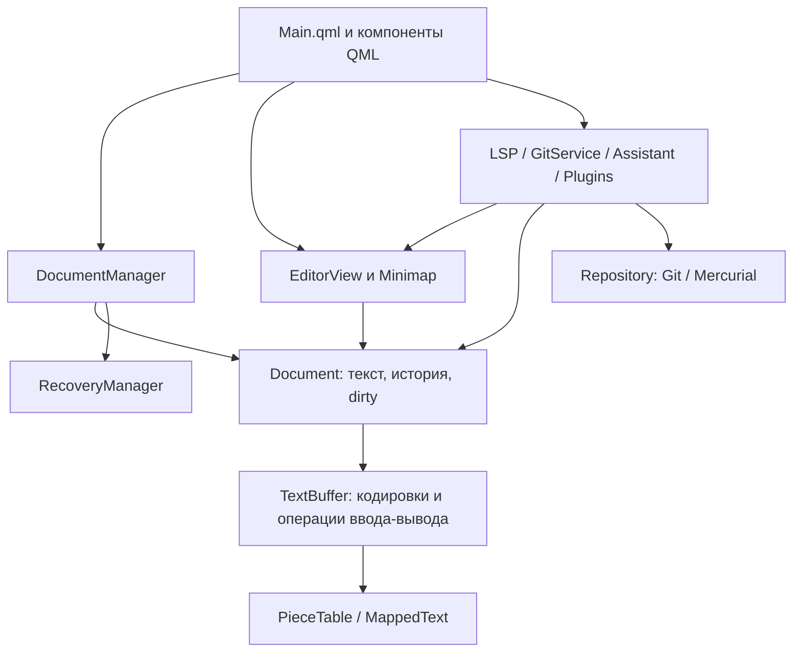

# Код-ревью и оценка архитектуры MyCodeApp

Проверка начата 4 ноября и завершена 5 ноября 2026 года (Europe/Moscow). Проверенный репозиторий: `C:/Projects/MyCodeApp/MyCodeApp`.
Снимок: `73d3d1683300b367a998379bd3ef8447e0ef5197`, версия приложения `1.0.2`.
Проверка относится к текущему состоянию проекта, а не к отдельному diff.

## Повторная проверка 21 ноября 2026 года

Все замечания ниже относятся к исходному снимку. В рабочем дереве после ревью
внесены следующие изменения.

| ID | Изменение | Что ещё проверить |
|---|---|---|
| R01–R04 | Сохранение возвращает результат, вкладка и recovery переживают ошибку. Загрузка формирует отдельный буфер в worker. Менеджер сопоставляет открытые и загружаемые пути. Необратимое преобразование в Windows-1251/Latin-1 прерывает сохранение. | Проверить диалог и обе половины окна вручную, прогнать санитайзеры. |
| R05–R06 | Форматирование и исходный документ для rename проверяются по ревизии. Правки проекта ожидают загрузки всех целей. Навигация и восстановление сессии продолжаются по сигналу завершения открытия. | Прогнать сценарии с живым clangd, сменой вкладки и проекта, большой целью rename и изменением документа во время запроса. |
| R07–R08 | Журналы и сессии учитывают регистр путей вне Windows. Recovery сверяет заголовок, сохраняет принятую часть журнала и повторяет запись после отказа. | Проверить миграцию старых данных на Linux и короткую запись при дозаписи. |
| R09–R11 | Лимит и отмена проверяются внутри цикла совпадений. Поиск по проекту использует декодер редактора. Смена VCS-контекста сбрасывает счётчик задач предыдущего проекта. | Показать в UI факт усечения внутридокументного поиска. Прогнать смену проекта во время задержанной VCS-операции. |
| R12–R13 | JSON заменяется через QSaveFile с проверкой длины записи. При неполном фоновом чтении документ не публикуется. | Проверить отказ записи настроек и поведение mmap при внешнем усечении файла. |

На Windows с MSVC и Qt 6.10.3 собран Release. CTest прошёл 15 из 15
наборов, включая новые регрессии отказа сохранения, повторного открытия,
закрытия во время загрузки, кодировки, окончаний строк, сбоя записи журнала
и поискового лимита. Приёмка на Astra, Linux и macOS остаётся в рабочем плане.
Из распакованного Windows ZIP успешно запущено окно и открыт тестовый лог
136,9 МБ. Приложение измерило фоновое чтение и декодирование в 657 мс.
Для запуска без экрана использован offscreen-плагин локального Qt SDK.

## Область и метод проверки

Проведены инвентаризация исходников, чтение основных потоков управления, проверка сборки, запуск штатных тестов и отдельные проверки граничных сценариев. В `src`, `qml`, `tests`, `include`, `plugins` найдено 135 файлов C++/QML/JS; это размер области инвентаризации, а не заявление о построчной проверке каждого файла.

Предметно проверены:

- текстовое ядро: `PieceTable`, `TextBuffer`, `Document`, отображение файлов в память;
- открытие, сохранение, закрытие, восстановление, отслеживание внешних изменений;
- поиск по документу и проекту, сканирование проекта, настройки и сессии;
- управление LSP, применение правок сервера и транспорт JSON-RPC;
- сервис Git/Mercurial, общий интерфейс VCS и основные изменяющие операции;
- `EditorView`, основные связи в `Main.qml`, плагины и сетевой код ассистента;
- CMake, конфигурация CI, состав тестов и документация архитектуры.

Исходники приложения не исправлялись. В репозиторий добавлен только этот отчёт. Диагностическая программа и журналы оставлены в игнорируемом `build/Release`.

Обозначения: **P1** — исправить в первую очередь из-за риска потери данных или нарушения безопасности памяти; **P2** — значимый функциональный дефект или нарушение надёжности. «Воспроизведено» означает запуск проверки; «статически» — вывод из конкретного пути исполнения, без заявления о фактически наблюдавшемся падении.

## Результат и приоритеты

Архитектура имеет хорошую основу для настольного редактора: есть самостоятельное текстовое ядро, единый путь редактирования с undo/redo, снимки для фоновых вычислений и интерфейс для двух VCS. Основные проблемы сосредоточены в управлении временем жизни задач, идентичностью документа и обработкой ошибок на границах сервисов.

Выделено **13 замечаний: 5 уровня P1 и 8 уровня P2**. До устранения P1 я бы не рекомендовал выпускать эту версию как редактор для важных рабочих файлов. Это оценка обнаруженных сценариев, а не утверждение, что обычное редактирование не работает.

| ID | Приоритет | Замечание | Проверка |
|---|---|---|---|
| R01 | P1 | Закрытие вкладки после неудачного сохранения уничтожает правки | Воспроизведено на последовательности вызовов из QML |
| R02 | P1 | Фоновая загрузка использует `Document` без гарантии его времени жизни | Статически |
| R03 | P1 | Один файл открывается несколькими независимыми документами | Воспроизведены два варианта |
| R04 | P1 | Сохранение в однобайтовой кодировке молча теряет символы | Воспроизведено для Windows-1251 |
| R05 | P1 | Ответ форматирования LSP применяется к уже изменённому тексту | Статически |
| R06 | P2 | Workspace edit пропускает асинхронно открываемые файлы | Статически, контракт открытия проверен запуском |
| R07 | P2 | Журналы разных путей с различным регистром сталкиваются на Linux | Статически; Linux не запускался |
| R08 | P2 | Журнал восстановления отбрасывает данные при ошибке записи | Статически; ошибка диска не инъецировалась |
| R09 | P2 | Лимит поиска и отмена не работают внутри длинной строки | Превышение лимита воспроизведено |
| R10 | P2 | Поиск по проекту использует другую политику кодировок | Статически |
| R11 | P2 | При смене проекта во время Git-операции зависает `busy` | Статически |
| R12 | P2 | Настройки и сессии записываются с предварительным уничтожением старой версии | Статически |
| R13 | P2 | Неполное чтение большого файла считается успешной загрузкой | Статически; сбой чтения не инъецировался |

## Подтверждённые замечания

### R01. P1 — закрытие после ошибки сохранения удаляет и документ, и восстановление

Места: [Main.qml:972](C:/Projects/MyCodeApp/MyCodeApp/Main.qml:972), [DocumentManager::save:220](C:/Projects/MyCodeApp/MyCodeApp/src/services/documentmanager.cpp:220), [DocumentManager::close:185](C:/Projects/MyCodeApp/MyCodeApp/src/services/documentmanager.cpp:185).

Обработчик выполняет `manager.save(index); manager.close(index)` без проверки результата. `save()` возвращает `void` и только посылает `errorOccurred`. Последующий `close()` вызывает `m_recovery->discard(doc)` и удаляет документ. Ошибка записи превращается в безвозвратную потерю несохранённых правок. В основном окне ошибка менеджера также направлена только в `console.warn` (`Main.qml:211`).

Проверка: открыт временный файл, внесены правки; на месте файла создан каталог, чтобы гарантировать ошибку записи. После `save()` получены `errors=1`, `dirty=1`; после `close()` вкладка удалена. Это проверка той же последовательности C++-вызовов, которая записана в QML, без нажатия кнопки через GUI.

Исправление: вернуть из сохранения явный результат; закрывать документ только после успешного сохранения. Предпочтительно вынести операцию `saveAndClose(documentId)` в сервис. При ошибке оставить вкладку, dirty и recovery-журнал, показать сообщение пользователю. Регрессионная проверка должна включать отказ записи и отсутствие потери текста/журнала.

### R02. P1 — время жизни Document не связано с фоновой загрузкой

Места: [Document::loadAsync:32](C:/Projects/MyCodeApp/MyCodeApp/src/core/document.cpp:32), [Document:36](C:/Projects/MyCodeApp/MyCodeApp/src/core/document.h:36), [DocumentManager::open:139](C:/Projects/MyCodeApp/MyCodeApp/src/services/documentmanager.cpp:139), [создание QML engine:126](C:/Projects/MyCodeApp/MyCodeApp/main.cpp:126).

Задача глобального `QThreadPool` захватывает сырой `this`, пишет в `m_buffer` и вызывает `invokeMethod(this, ...)`. `Document` является дочерним объектом менеджера. У документа и менеджера нет собственного протокола отмены/ожидания этой загрузки. При уничтожении QML engine на выходе менеджер может удалить документ, пока задача ещё выполняется или стоит в очереди. Ожидание завершения глобального пула позднее не продлевает жизнь уже удалённого документа.

Последствие: путь к use-after-free при закрытии приложения во время загрузки большого файла, особенно с медленного диска. Само падение в этой проверке не воспроизводилось; отсутствие защиты видно непосредственно в коде.

Исправление: задача должна формировать отдельный результат загрузки без обращения к `Document`; доставка результата — в GUI-потоке через живой объект-получатель. Ввести владельца задач, токен отмены и определённый порядок shutdown. Одной проверки `QPointer` перед последующим разыменованием в worker недостаточно для устранения гонки удаления.

### R03. P1 — нет единственного документа на один файл

Места: [DocumentManager::open:132](C:/Projects/MyCodeApp/MyCodeApp/src/services/documentmanager.cpp:132), [pathKey:107](C:/Projects/MyCodeApp/MyCodeApp/src/services/documentmanager.cpp:107), [publish:69](C:/Projects/MyCodeApp/MyCodeApp/src/services/documentmanager.cpp:69), [RecoveryManager::watch:97](C:/Projects/MyCodeApp/MyCodeApp/src/services/recovery.cpp:97).

`open()` сравнивает опубликованные пути обычным `==`, хотя рядом существует платформенный `pathKey()`. Загружаемые документы из `m_loadingDocs` вообще не проверяются. Поэтому разные варианты регистра в Windows и два открытия большого файла до завершения загрузки создают независимые буферы и истории одного физического файла.

Воспроизведено: открытие `recovery.txt` и `RECOVERY.txt` дало две вкладки; два немедленных открытия одного файла размером 21 МиБ также дали две вкладки после завершения загрузки. Разные правки этих документов могут перезаписать друг друга при сохранении. Их журналы используют один путь; закрытие одной копии может удалить журнал другой.

Исправление: хранить опубликованные и загружаемые документы в общем реестре по нормализованной идентичности файла; повторное открытие должно присоединяться к текущей загрузке. Для существующих файлов отдельно определить политику canonical path/симлинков. Split view должен разделять один `Document`, как уже предусмотрено в текущем интерфейсе.

### R04. P1 — успешное сохранение не гарантирует сохранность символов

Места: [stringToCp1251:40](C:/Projects/MyCodeApp/MyCodeApp/src/core/textbuffer.cpp:40), [TextBuffer::save:220](C:/Projects/MyCodeApp/MyCodeApp/src/core/textbuffer.cpp:220), [Document::saveAs:83](C:/Projects/MyCodeApp/MyCodeApp/src/core/document.cpp:83).

`stringToCp1251()` заменяет отсутствующие символы на `?`; `QString::toLatin1()` также не обеспечивает обратимого преобразования произвольного текста. Ошибка кодирования не возвращается. Затем `saveAs()` отмечает документ чистым и recovery удаляется, хотя в памяти и на диске уже разный текст.

Воспроизведено: файл Windows-1251 с текстом «Привет», вставка `你`, сохранение. Получено `success=1`, `dirty=0`; в памяти последний символ остался `你`, на диске последний байт — `3f` (`?`).

Исправление: до записи проверять представимость всего текста. При невозможности сохранить вернуть явную ошибку и сохранить dirty; предложить пользователю переход в UTF-8. Изменение кодировки также должно быть частью согласованного состояния документа. Проверить Windows-1251 и Latin-1, кириллицу, символы CJK и emoji.

### R05. P1 — форматирование LSP может перезаписать более свежие правки

Места: [LspManager::format:705](C:/Projects/MyCodeApp/MyCodeApp/src/lsp/lspmanager.cpp:705), [applyWorkspaceEdit:722](C:/Projects/MyCodeApp/MyCodeApp/src/lsp/lspmanager.cpp:722), [Document::replace:110](C:/Projects/MyCodeApp/MyCodeApp/src/core/document.cpp:110).

Форматирование запоминает указатель документа, но не ревизию текста. Ответ применяется, если это всё ещё тот же документ. Пользователь может ввести или удалить строки, пока сервер считает результат; диапазоны ответа относятся к старому тексту. Особенно опасен ответ с заменой всего документа: новые символы будут затёрты старой версией форматтера. В обработке `documentChanges` поле версии также не проверяется.

Исправление: добавить монотонную ревизию `Document`, запоминать её вместе с запросом и отклонять либо пересчитывать ответ при несовпадении. Для нескольких файлов валидировать версии/снимки до применения набора. Наличие версионированных правок предусмотрено [спецификацией WorkspaceEdit](https://github.com/microsoft/language-server-protocol/blob/gh-pages/_specifications/lsp/3.17/types/workspaceEdit.md). Проверка: задержать ответ форматтера, изменить документ, затем доставить ответ и убедиться, что новые правки не исчезли.

### R06. P2 — асинхронное открытие нарушает применение правок и восстановление позиции

Места: [applyWorkspaceEdit:735](C:/Projects/MyCodeApp/MyCodeApp/src/lsp/lspmanager.cpp:735), [DocumentManager::open:140](C:/Projects/MyCodeApp/MyCodeApp/src/services/documentmanager.cpp:140), [restoreSession:134](C:/Projects/MyCodeApp/MyCodeApp/Main.qml:134), [openAt:169](C:/Projects/MyCodeApp/MyCodeApp/Main.qml:169).

Для файла больше 20 МиБ `openPath()` запускает загрузку и возвращает `-1`. `applyWorkspaceEdit()` немедленно вызывает `documentAt(-1)`, получает `nullptr` и пропускает правки. После загрузки повторного применения нет. Сообщение об успехе использует `byPath.size()`, поэтому сообщает изменение и пропущенных файлов. Большой файл может быть целью правки из небольшого открытого файла; ограничение размера для отслеживания LSP этого сценария не исключает.

Тот же контракт влияет на переход к строке и восстановление сессии: действия выполняются только при синхронном получении индекса. Для асинхронных вкладок теряются отложенные координаты и состояние split.

Исправление: явный результат `open` с состоянием «уже открыт / загружается / ошибка» и идентификатором запроса; продолжать операцию по готовности конкретного документа. Сначала подготовить все цели workspace edit, затем применять правки и считать фактически изменённые документы. Нужен интеграционный тест rename с неоткрытым файлом больше порога загрузки.

### R07. P2 — приведение пути к нижнему регистру смешивает recovery разных файлов

Места: [RecoveryManager::logPathFor:74](C:/Projects/MyCodeApp/MyCodeApp/src/services/recovery.cpp:74), [RecoveryManager::restore:127](C:/Projects/MyCodeApp/MyCodeApp/src/services/recovery.cpp:127), [Workspace::sessionPath:190](C:/Projects/MyCodeApp/MyCodeApp/src/services/workspace.cpp:190).

Recovery безусловно делает `toLower()` перед вычислением имени журнала. На файловой системе Linux с учётом регистра `A.cpp` и `a.cpp` — разные файлы, но журнал у них один. При совпадении размера и времени изменения `restore()` не сверяет `header.path` и может проиграть правки чужого файла. При несовпадении журнал просто удаляется. Аналогичная коллизия есть у сессий разных корней проекта.

Это вывод из кода для Linux; запуск на Linux не выполнялся. Успешная проверка case alias в Windows в диагностической программе не является воспроизведением Linux-дефекта.

Исправление: общий платформенный сервис идентичности пути, учитывающий принятые правила файловой системы; как минимум использовать согласованную с `DocumentManager::pathKey` политику регистра. При восстановлении проверить соответствие идентичности документа заголовку. Добавить Linux-тест с двумя различающимися только регистром файлами и проектами.

### R08. P2 — ошибка записи recovery теряет очередь правок

Место: [RecoveryManager::flush:189](C:/Projects/MyCodeApp/MyCodeApp/src/services/recovery.cpp:189).

После `file.write(it->pending)` результат игнорируется, `pending` очищается и выставляется `started=true`. Если файл открылся, но запись завершилась ошибкой или записала только часть данных, правки исчезают из памяти. Следующие записи дописываются за оборванным блоком, а восстановление остановится на нём. Успешный `open()` не гарантирует успешный `write()`.

Исправление: учитывать точное число записанных байтов и состояние завершения записи; удалять из pending только надёжно принятую часть, повторять запись и сообщать ошибку. Продумать кадрирование/контроль целостности записей, чтобы можно было восстановить максимум корректных блоков. Для проверки нужен управляемый I/O-адаптер с короткой записью и отказом, а не заполнение рабочего диска.

### R09. P2 — предохранитель поиска стоит за неограниченным внутренним циклом

Место: [SearchEngine::search:45](C:/Projects/MyCodeApp/MyCodeApp/src/services/searchengine.cpp:45).

Ограничение `kMaxMatches` проверяется только после обработки целой строки. На одной строке с миллионами совпадений результат превышает объявленный предел. Отмена также проверяется только перед обработкой некоторых строк и не прерывает внутренний цикл. Закрытие `SearchEngine` ожидает его завершения, поэтому такая задача способна задержать закрытие приложения.

Воспроизведено: строка из 1 100 000 символов `a`, поиск `a`, результат содержит 1 100 000 совпадений при лимите 1 000 000.

Исправление: проверять лимит и токен отмены внутри цикла совпадений с разумной периодичностью; возвращать признак усечения. Добавить тест длинной строки и ограниченного времени отмены. Пустой запрос также стоит отсеивать в публичном API движка: сейчас `EditorView` защищает этот путь, но сам `SearchEngine` не защищён.

### R10. P2 — поиск по проекту не понимает часть поддерживаемых редактором кодировок

Места: [ProjectSearch::decode:14](C:/Projects/MyCodeApp/MyCodeApp/src/services/projectsearch.cpp:14), [TextBuffer::loadFromData:128](C:/Projects/MyCodeApp/MyCodeApp/src/core/textbuffer.cpp:128).

Открытие документа поддерживает Windows-1251 и Latin-1 с автоопределением. Поиск по проекту распознаёт только UTF-16 BOM, а остальные байты декодирует как UTF-8. Русский текст Windows-1251, который правильно виден и находится в открытом редакторе, не будет найден тем же запросом через поиск по проекту. Независимые декодеры уже разошлись по поведению.

Исправление: единая функция декодирования и нормализации для редактора, проектного поиска и VCS. Сохранять исходные сведения о кодировке и BOM отдельно от нормализованного текста. Проверить поиск одного и того же слова в UTF-8, UTF-16, Windows-1251 и Latin-1.

### R11. P2 — GitService оставляет busy после смены проекта

Места: [GitService::run:120](C:/Projects/MyCodeApp/MyCodeApp/src/git/gitservice.cpp:120), [runOperation:147](C:/Projects/MyCodeApp/MyCodeApp/src/git/gitservice.cpp:147), [setRootPath:102](C:/Projects/MyCodeApp/MyCodeApp/src/git/gitservice.cpp:102), [runDiff:515](C:/Projects/MyCodeApp/MyCodeApp/src/git/gitservice.cpp:515).

`runOperation()` и `runDiff()` увеличивают `m_running`, а уменьшают его только в callback `done`. После смены корня `run()` отбрасывает callback из-за несовпадения generation. `setRootPath()` счётчик не сбрасывает. Операция старого проекта заканчивается, но положительный `m_running` остаётся; `busy` нового проекта может остаться включённым навсегда.

Исправление: разделить обязательное завершение/учёт задачи и публикацию её результата. Устаревший результат не должен обновлять новый проект, но освобождение ресурсов и счётчика должно выполняться всегда. Подойдёт отдельный контекст задач на поколение. Проверка: запустить задержанную VCS-операцию или diff, сменить корень, дождаться завершения и проверить `busy=false`.

### R12. P2 — сохранение настроек и сессий неатомарно и маскирует короткую запись

Места: [writeJsonFile:50](C:/Projects/MyCodeApp/MyCodeApp/src/services/appsettings.cpp:50), [setAppSetting:63](C:/Projects/MyCodeApp/MyCodeApp/src/services/appsettings.cpp:63), [Workspace::saveSession:201](C:/Projects/MyCodeApp/MyCodeApp/src/services/workspace.cpp:201).

`QFile` открывается с `WriteOnly`, что уничтожает содержимое существующего файла до окончания записи новой версии. При сбое останется пустой или повреждённый JSON. Условие `write(...) >= 0` считает короткую запись успехом, а вызывающий `setAppSetting()` игнорирует даже возвращаемый `false`. Теряются настройки, параметры подключения и сессии; следующий read-modify-write способен закрепить потерю остальных ключей.

Исправление: `QSaveFile`, проверка полной длины записи и `commit()`, передача ошибки вызывающему коду. Атомарная замена уже используется в `TextBuffer::save`, поэтому подход можно унифицировать. Гарантии временного файла и обработки ошибки описаны в [документации QSaveFile для Qt 6.11](https://doc.qt.io/qt-6.11/qsavefile.html). Проверить сохранность предыдущей версии JSON при искусственном отказе.

### R13. P2 — ошибка чтения публикует обрезанный файл как корректный

Место: [Document::loadAsync:53](C:/Projects/MyCodeApp/MyCodeApp/src/core/document.cpp:53).

При `file.read(...) <= 0` цикл прекращается; затем буфер уменьшается до `done`, декодируется, и результат декодирования определяет успех загрузки. Не проверяется ни отрицательный результат чтения, ни соответствие прочитанного объёма ожидаемому. При ошибке диска или усечении файла во время загрузки можно получить чистый документ с одним префиксом исходного текста. Последующее сохранение закрепит усечение.

Исправление: различать EOF и ошибку, проверять ожидаемый объём и согласованность состояния файла. При незавершённом чтении не публиковать успешный документ; вернуть явную ошибку либо предложить повторное открытие. Для mapped и обычного пути определить единую политику изменения файла во время загрузки. Нужен тест с источником, возвращающим часть данных и затем ошибку.

## Оценка архитектуры

### Существующие границы



Схема показывает основные зависимости, а не все сигналы. Архитектура — модульный монолит с выделенными каталогами. Границы в основном поддерживаются соглашениями; сборка не выделяет ядро и сервисы в отдельные внутренние библиотеки.

### Что сделано удачно

1. **Модель текста отделена от представления.** `PieceTable` и `TextBuffer` не включают GUI или сервисы. Qt-типы в ядре для Qt-приложения сами по себе не являются недостатком. Один `Document` можно показывать в двух `EditorView`.
2. **Есть единый путь пользовательских правок.** `Document::replace`, undo/redo и сигналы изменений позволяют согласовывать несколько видов, свёртку, подсветку и recovery. Это сильная точка для последующего введения ревизий и транзакций.
3. **Снимки подходят для фоновых вычислений.** COW-контейнеры позволяют передавать состояние поиска и tree-sitter без постоянной блокировки живого документа. Важно сохранять это свойство при дальнейшей оптимизации.
4. **VCS отделена интерфейсом.** `vcs::Repository` позволяет поддерживать Git и Mercurial без ветвления всей панели по реализации. Последовательная очередь GitService уместна для изменяющих операций.
5. **Сложная логика частично выделена в чистые функции.** Правила редактирования, свёртка, сниппеты, подготовка запросов ассистента тестируются отдельно от окна и сети.
6. **Тесты и CI уже есть.** В CMake зарегистрированы 15 наборов; CI содержит Windows/Linux/macOS, ASan+UBSan, TSan и clang-tidy. Это хорошая база, хотя конфигурация CI не доказывает, что удалённые проверки сейчас зелёные.
7. **Для обычного текста выбрана атомарная запись.** `TextBuffer::save` корректно проверяет полный размер записи и `commit`; проблема R01 находится выше этого уровня.

### Главные архитектурные ограничения

| Область | Оценка | Основание |
|---|---|---|
| Разделение модели текста и GUI | Хорошо | Самостоятельное ядро и общий Document для нескольких видов |
| Владение задачами и завершение работы | Требует доработки | Несогласованные подходы: локальные пулы с ожиданием и глобальные задачи с сырым this |
| Согласованность данных | Требует доработки | Нет общей идентичности файла, ревизии документа и подготовки workspace edit |
| Расширяемость | Хорошо для текущего масштаба | Общая VCS, ресурсы языков, тем и сниппетов, версионированный IID плагинов |
| Тестируемость интеграций | Средне | Хорошее покрытие алгоритмов, мало тестов оркестрации сервисов |
| Воспроизводимость сборки | Средне | Версии зависимостей указаны, но много требований и глобальных настроек в одном CMake |

Это качественная инженерная оценка, а не вычисленный индекс качества или результат измерения покрытия.

**Слишком много обязанностей в EditorView.** Файл содержит 2556 физических строк: ввод, курсоры, выделения, snippets, undo-связи, поиск, folding, wrap, подсветку, диагностику и Scene Graph. Это повышает стоимость изменения любого поведения. Выделять стоит по стабильным обязанностям: контроллер ввода/команд, модель состояния вида, построитель визуальных строк, renderer. Сам размер файла не считается функциональным дефектом.

**Main.qml стал оркестратором сценариев.** 990 строк связывают сессию, навигацию, документы, split, Git, LSP и меню. R01 и R06 показывают, что бизнес-сценарии уже плохо выражаются последовательностями вызовов из QML. Операции «сохранить и закрыть», «открыть и перейти», «восстановить сессию» должны иметь собственное завершение и результат на уровне сервисов.

**Сервисы зависят от конкретного EditorView.** LSP, Git, ассистент и плагины принимают указатели GUI. Это удобно для начала, но затрудняет проверку сценариев без сцены Qt Quick. Полезен небольшой интерфейс команд редактирования/состояния вида, работающий через `DocumentId`, диапазоны и ревизию. Не требуется переписывать все Qt-сервисы на абстрактные интерфейсы сразу.

**Отсутствуют сквозные контракты.** Нужны единые `FileIdentity`, `DocumentRevision`, результат открытия и результат записи. Политика кодировок, сравнения путей и ошибок сейчас дублируется; R03, R07 и R10 — конкретные следствия. Ошибка должна доходить до пользовательского сценария, а не обрываться на сигнале или `console.warn`.

**Персистентность неоднородна.** Основной файл сохраняется атомарно, JSON — через truncate, recovery — без проверки write. Следует разделить снимки, атомарно заменяемые целиком, и дописываемый журнал, для которого нужны отдельные гарантии целостности и восстановления. Подменять append-журнал простым QSaveFile без пересмотра формата не следует.

**Производительность PieceTable имеет пределы.** Снимок дешёвый, но правки не имеют универсальной логарифмической сложности: `rebuildOffsets()` проходит по кускам, вставка/удаление сдвигают хвост массива переводов строк; `added` сохраняет отдельный буфер каждой вставки. Undo также создаёт новые вставки. Для длительной сессии надо измерять число кусочков, удерживаемую память и задержки при изменениях в начале большого файла, особенно пока снимок удерживается worker. Возможные следующие шаги — объединение соседних кусочков, безопасная компактизация и дерево с агрегатами. Замена структуры оправдана результатами таких измерений, а не только её названием.

**CMake не закрепляет часть заявленных требований.** На строке 7 включён `CMAKE_CXX_STANDARD_REQUIRED`, но сам стандарт не задан; в проверенной команде компиляции `main.cpp` нет `-std`. README заявляет C++20 — это стоит закрепить через `target_compile_features(... cxx_std_20)` или скорректировать документацию. В `find_package` безусловно нужны Test, LinguistTools и приватные Qt-модули. Желательны `BUILD_TESTING`, внутренние targets `editor_core`, `editor_services`, `editor_gui`, изоляция приватных Qt API и явные минимальные версии. Это улучшения контракта сборки, а не доказательство её текущей неработоспособности.

**Инструменты CI не все блокируют ошибки.** TSan помечен `continue-on-error` с объяснением про неинструментированный Qt; clang-tidy тоже разрешено падать. Сохранять отчёты полезно, но для выбранных проверок собственного кода нужен постепенно ужесточаемый обязательный набор. Отключение leak checking означает, что утечки этой конфигурацией не проверяются.

### Направление развития

Сохранить существующее текстовое ядро и модульный монолит. Первая цель — надёжные контракты между модулями, затем постепенное выделение обязанностей.

- `DocumentRegistry`: единая идентичность файлов, опубликованные и загружаемые документы, завершение открытия.
- `Document`: текст, монотонная ревизия, история, dirty и пакетное применение правок.
- `DocumentIo`: загрузка и сохранение как операции с результатом, без записи worker в уничтожаемый QObject.
- `WorkspaceEditApplier`: подготовка файлов, проверка ревизий, применение и честный отчёт о результате.
- `TaskScope`: владелец фоновых задач, отмена, обязательная финализация и shutdown; сначала использовать в проблемных местах, не превращать в универсальный фреймворк.
- `EditorView`: состояние представления и рендер; внешние команды проходят через ограниченный интерфейс.

## Проверки и ограничения

### Выполненные команды и результаты

Среда: Windows 11 x64, Qt 6.11.2 MinGW, GCC 13.1.0, существующая конфигурация Release. Использовались инструменты из `C:/Qt`, найденные через `CMakeCache.txt`; каталоги Qt и MinGW добавлялись в PATH только дочерних PowerShell-процессов.

```powershell
& 'C:/Qt/Tools/CMake_64/bin/cmake.exe' --build build/Release --parallel 4
# ninja: no work to do. Код сборки: 0.

& 'C:/Qt/Tools/CMake_64/bin/ctest.exe' --test-dir build/Release --output-on-failure --timeout 90
# Первый полный запуск: 14 из 15 наборов прошли, editorview завершился с ошибкой.
# Общее время: 18,02 с; у упавшего набора диагностического текста не было.

& ./build/Release/test_editorview.exe -o 'build/Release/review-editorview.txt,txt'
# Повторный прямой запуск: 33 passed, 0 failed, 9,095 с.

& 'C:/Qt/Tools/CMake_64/bin/ctest.exe' --test-dir build/Release -R '^editorview$' --output-on-failure --timeout 90
# Повтор через CTest: 1/1 Passed, 7,63 с суммарно.
```

Итог: каждый штатный набор успешно прошёл хотя бы один запуск, но первый полный прогон был красным. Причина первого отказа editorview не установлена. Нельзя считать доказанным ни дефект продукта, ни конкретную причину нестабильности; для следующего воспроизведения нужно сохранять подробный вывод QtTest прямо из CI/CTest.

Дополнительная программа использовала реальные `Document`, `RecoveryManager`, `SearchEngine`, `DocumentManager`. Она собрана отдельно в `build/Release` с теми же библиотеками Qt и объектами ядра; исходники продукта не подменялись. Файлы и ошибочная цель сохранения создавались в `QTemporaryDir`. Вывод:

```text
lossy_save: success=1 dirty=0 memory=d09fd180d0b8d0b2d0b5d182e4bda0 disk=cff0e8e2e5f23f
search_cap: matches=1100000 declared_limit=1000000
journal_case_alias: restored=1 text=abcXYZ
duplicate_case_alias: tabs=2
close_after_failed_save: errors=1 dirty_before_close=1 remaining_tabs=1
duplicate_async_open: tabs=2 loading=0
```

`remaining_tabs=1` означает, что из двух открытых в этой проверке копий удалена одна, несмотря на ошибку её сохранения. `journal_case_alias` — контроль корректного соответствия двум вариантам одного пути в Windows, а не отдельный дефект.

Диагностические материалы:

- [исходник дополнительных проверок](C:/Projects/MyCodeApp/MyCodeApp/build/Release/review-probes.cpp);
- [вывод дополнительных проверок](C:/Projects/MyCodeApp/MyCodeApp/build/Release/review-probes.txt);
- [подробный успешный запуск EditorViewTest](C:/Projects/MyCodeApp/MyCodeApp/build/Release/review-editorview.txt).

Эти материалы находятся в каталоге сборки и исчезнут при его очистке; существенные результаты и условия воспроизведения сохранены в этом отчёте.

### Что пока не проверено

- Чистая сборка со скачиванием всех зависимостей: проверялась существующая конфигурация, Ninja не нашёл изменений для пересборки.
- Запуск на Linux, Astra Linux и macOS, упаковка и установка пакетов.
- ASan/UBSan/TSan локально и состояние удалённых GitHub Actions.
- Отказы диска, частичные чтения/записи, внезапное отключение питания и процессное воспроизведение use-after-free.
- Живые ответы clangd/qmlls/pyright, сетевой сервер модели и сторонние бинарные плагины.
- Полное ручное прохождение GUI, проверка всех языков/грамматик и измерение покрытия тестами.
- Формальная проверка соответствия техническому заданию. Эта работа — ревью кода и архитектуры; приложенный в репозитории Word-документ не использовался как проверенный источник требований.

Отсутствие замечания по конкретному модулю не является гарантией отсутствия дефектов.

## План улучшений

### Этап 1 — исключить потерю правок и ошибки памяти

1. R01: результат сохранения и единая операция сохранения с закрытием; ошибка видна пользователю.
2. R02: безопасный жизненный цикл загрузки и завершения приложения.
3. R03: общий реестр документов и ожидающих открытий.
4. R04: запрет молчаливого необратимого кодирования.
5. R05: ревизия документа и защита от устаревших правок LSP.

Критерий готовности: сценарии ошибки записи, двойного открытия, закрытия при загрузке и изменения текста во время форматирования покрыты проверками, пользовательский текст и recovery не теряются.

### Этап 2 — привести сервисы к согласованным контрактам

1. R06: отложенные действия после открытия, подготовка workspace edit и корректные счётчики результата.
2. R07, R10: общие правила идентичности файла и декодирования.
3. R08, R12, R13: явные результаты всех операций I/O и тесты отказов через управляемые адаптеры.
4. R09: лимиты и отмена внутри больших операций.
5. R11: обязательная финализация устаревших задач и проверка смены проекта.

Критерий готовности: сервисные сценарии не опираются на предположение, что открытие всегда синхронно, а сигнал ошибки автоматически останавливает вызывающий код.

### Этап 3 — снизить стоимость развития

1. Выделить внутренние CMake-targets и явно закрепить стандарт C++/варианты сборки.
2. Выносить обязанности из EditorView и сценарии из Main.qml небольшими изменениями с сохранением поведения.
3. Добавить тесты DocumentManager, ProjectSearch, отложенного LSP и смены контекста GitService; алгоритмические тесты уже дают полезную базу.
4. Сохранять полный диагностический вывод нестабильных GUI-тестов и сделать выбранные проверки анализа обязательными.
5. Измерить долгую сессию редактирования и память PieceTable; решать вопрос компактизации по результатам, сохраняя корректность живых снимков и undo.

Переписывание проекта целиком не требуется. Наибольший эффект дадут исправления контрактов сохранения, открытия и применения асинхронных результатов.
